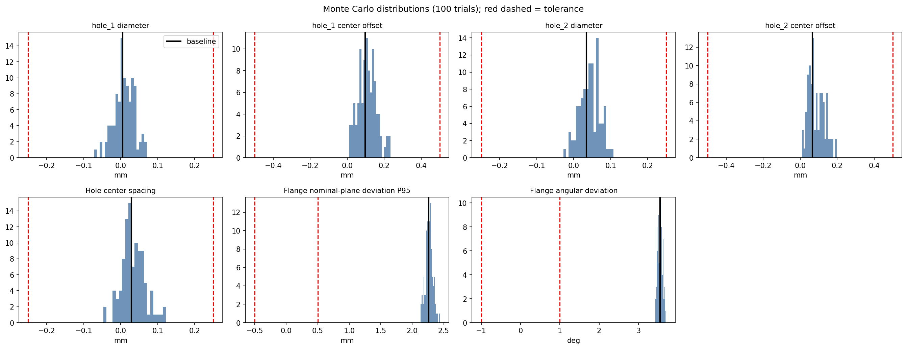

# 3D Scan-to-CAD Dimensional Inspection System

**An automated 3D inspection prototype that registers a point-cloud scan to its nominal CAD model, measures features, estimates measurement uncertainty, and returns PASS / FAIL / REVIEW decisions with structured reports.**

Built with Python, Open3D, NumPy and SciPy.



## Highlights

- **Registration you can trust:** FPFH + RANSAC global alignment, ICP refinement, then a second ICP on an undeformed datum region so the defect cannot bias the alignment.
- **Catching a silent failure:** registration sometimes converged **~180° from the truth while reporting ~98.7% ICP fitness**. A feature-aware gate plus multi-start registration raised correct-pose acceptance from **16/20 to 20/20**, with **zero wrong poses accepted**.
- **Measurements that know their limits:** bounded circle fitting with angular-coverage checks. 78 points covering only half a hole pass a point-count rule, but the coverage gate returns REVIEW.
- **Uncertainty-aware decisions:** Monte Carlo perturbation gives an expanded uncertainty for every check, used to guard-band PASS / FAIL decisions.
- **Real data:** on Real3D-AD scans, local DBSCAN clustering separated a bulge defect that global statistics missed.

## Overview

Manufacturing inspection compares a produced part with its nominal CAD design. Real 3D scans make this hard: they are noisy, incomplete, arrive in an unknown pose, and contain the very defects that distort alignment.

This project implements a modular **scan-to-CAD inspection pipeline**. It was developed on a synthetic L-bracket experiment with a known ground truth, then tested on real scans from the Real3D-AD dataset.

## Pipeline

```text
Nominal CAD mesh (STL)        Raw 3D scan (PLY)
           |                          |
           +------------+-------------+
                        v
              Load and validate geometry
                        v
         Coarse alignment: FPFH + RANSAC
                        v
       Fine alignment: ICP + stable-region ICP
                        v
     Multi-start registration (best passing attempt)
                        v
   Registration quality gate: fitness, RMSE, holes found
              |                         |
          ACCEPTABLE                  REVIEW --> stop inspection
              v
   Hole and flange measurements + coverage checks
              v
   Monte Carlo measurement uncertainty (optional)
              v
   Tolerance evaluation: PASS / FAIL / REVIEW
              v
   DBSCAN defect localisation
              v
   JSON report + coloured deviation point cloud
```

## 1. Synthetic L-bracket experiment

The nominal part is an L-bracket (about **15 × 49.5 × 49.5 mm**) with two mounting holes in its horizontal flange.

A synthetic "as-built" scan was generated with a known answer:

| Step | Setting |
|---|---|
| Defect | Horizontal flange warped linearly for y > 30 mm, up to **3.0 mm** at the tip |
| Sampling | 10,000 Poisson-disk points from the defective mesh |
| Noise | Gaussian, σ = 0.10 mm |
| Missing data | 10% of points removed at random |
| Outliers | 150 random points within the bounding box ± 5 mm |
| Unknown pose | 25° rotation about z plus a (20, 35, 15) mm translation |

The ground truth is saved separately for evaluation. **The inspection pipeline never reads it.**

### What is measured

- Hole 1 and Hole 2 diameters
- Hole-centre positions relative to the CAD
- Hole centre-to-centre spacing
- Horizontal-flange deviation from the nominal plane (95th percentile)
- Angular deviation between the nominal and measured flange planes

Each check returns:

| Status | Meaning |
|---|---|
| PASS | The measurement satisfies the tolerance rule |
| FAIL | The measurement violates the tolerance rule |
| REVIEW | Evidence is insufficient: poor registration, poor coverage, or too close to a limit to decide |

Tolerances are demonstration values defined in `configs/inspection_config.json`. These are prototype decisions, not certified metrology results.

## 2. Registration robustness

### The 180° failure

Repeated runs of FPFH + RANSAC + ICP occasionally converged to a pose about **180°** from the ground truth, while ICP fitness stayed at about **98.7%**. The bracket is nearly symmetric, so a flipped pose still overlaps most surfaces. **High fitness alone does not validate registration.**

### Feature-aware validation

After alignment, both mounting holes must be measurable at the positions the CAD predicts. A flipped pose places flat material or empty space there, so the circle fit fails and the registration is flagged for REVIEW. The gate cannot always tell a wrong pose from a correctly aligned but occluded hole; both return REVIEW, which is the safe outcome.

### Stable-region (datum) ICP

ICP minimises squared distances over all points, so the warped flange pulls the alignment towards the defect. After the first ICP, a second ICP runs only on the undeformed region (y < 25 mm) and the two transforms are composed.

### Multi-start registration

RANSAC is stochastic, so registration is attempted several times. Candidates must pass the basic quality checks and the feature gate; the lowest-RMSE passing candidate is kept.

| Metric | Single-start | Multi-start |
|---|---:|---:|
| Trials | 20 | 20 |
| Correct poses accepted | 16 | 20 |
| Incorrect poses accepted | 0 | 0 |
| REVIEW outcomes | 4 | 0 |
| Acceptance rate | 80% | 100% |
| Mean runtime | 2.79 s | 7.08 s |

Multi-start raised the observed acceptance rate by 20 percentage points at about 2.5× the runtime. These are repeated stochastic trials on one synthetic scan, not evidence of general production reliability.

## 3. Dimensional measurement and coverage

Holes are measured by bounded non-linear least-squares circle fitting on wall points selected around the expected centre. A fit is accepted only if it passes all of:

- at least 50 candidate wall points
- solver convergence and a finite fit RMSE
- parameters not at their bounds
- fit RMSE ≤ 0.20 mm
- angular coverage ≥ 70% (36 sectors of 10°), with the largest unobserved gap also reported

**Point count is not evidence of coverage.** In a controlled partial-occlusion test, 78 densely packed points passed the point-count rule but covered only 50% of the circumference; the coverage gate correctly returned REVIEW.

The flange is measured by SVD plane fitting on top-face points segmented by region and surface normal.

### Repeatability

Twenty fixed-registration trials with additional Gaussian noise:

| Metric | Hole 1 | Hole 2 |
|---|---:|---:|
| Mean measured diameter | 4.998 mm | 5.020 mm |
| Sample standard deviation | 0.014 mm | 0.021 mm |
| Successful measurements | 20/20 | 20/20 |

These describe conditional synthetic repeatability, not complete sensor uncertainty.

## 4. Measurement uncertainty (Monte Carlo)

Each inspection quantity is re-measured over **100 perturbed copies** of the registered scan:

| Perturbation | Setting | Represents |
|---|---|---|
| Random point dropout | 10% | Varying surface coverage |
| Gaussian point noise | σ = 0.10 mm | Sensor noise |
| Random rotation | σ = 0.05° (assumed) | Residual registration error |
| Random translation | σ = 0.05 mm (assumed) | Residual registration error |

Nominal values are held fixed, with the CAD sampled once. The sample standard deviation gives a standard uncertainty *u*, and the expanded uncertainty *U* = 2*u* is used to **guard-band** each decision:

- **PASS** only if |error| + *U* ≤ tolerance
- **FAIL** only if |error| − *U* > tolerance
- **REVIEW** otherwise, or if the quantity fails to measure in more than 10% of trials

### Results on the warped bracket

| Check | Error | *U* (k = 2) | Tolerance | Decision |
|---|---:|---:|---:|:---:|
| Hole 1 diameter | 0.005 mm | 0.055 mm | 0.25 mm | PASS |
| Hole 1 centre offset | 0.096 mm | 0.097 mm | 0.50 mm | PASS |
| Hole 2 diameter | 0.035 mm | 0.053 mm | 0.25 mm | PASS |
| Hole 2 centre offset | 0.065 mm | 0.087 mm | 0.50 mm | PASS |
| Hole spacing | 0.029 mm | 0.063 mm | 0.25 mm | PASS |
| Flange P95 deviation | 2.264 mm | 0.115 mm | 0.50 mm | **FAIL** |
| Flange angular deviation | 3.552° | 0.120° | 1.00° | **FAIL** |

- The holes pass with wide margins even after accounting for uncertainty.
- The 3 mm flange warp remains a confident FAIL: 2.26 mm deviation against a 0.12 mm uncertainty.
- No decisions changed on this part, which is expected: guard banding only affects results near a tolerance limit. In a separate borderline test, a hole 0.195 mm oversize against a 0.2 mm tolerance (U = 0.006 mm) correctly moved from PASS to REVIEW.
- Hole 2 failed to measure in 1 of 100 trials, a reminder that sparse coverage makes measurements fragile.

**Limitations:** this is a sensitivity-based estimate under an assumed noise model, not a calibrated uncertainty budget. The registration perturbation sizes are assumptions. Adding noise to an already noisy scan biases some statistics upward (e.g. P95), so only the spread is used for decisions. The Monte Carlo step currently runs from the project notebook; results are saved to `benchmarks/monte_carlo_uncertainty/`.

## 5. Geometric defect detection

Flange points exceeding the deviation tolerance are clustered with **DBSCAN**. Each candidate defect is summarised by cluster ID, number of points, spatial centre, and maximum and mean absolute deviation. A coloured PLY highlights points beyond tolerance, using exact point-to-mesh distances from Open3D's `RaycastingScene`.

Cluster point counts depend on scan density and are not interpreted as physical defect area.

## 6. Real-world scan experiment (Real3D-AD)

The registration and deviation-analysis methods were tested on real scans from **Real3D-AD**: a normal candybar scan (`137_good.ply`) and a bulge-labelled scan (`347_bulge.ply`), each compared with a reference template (`123_template.ply`). This experiment uses point-cloud-to-point-cloud registration and nearest-neighbour distances rather than CAD-specific feature inspection.

| Metric | Normal scan | Bulge-labelled scan |
|---|---:|---:|
| ICP fitness | 1.000 | 1.000 |
| Median distance to template | 0.0676 | 0.0667 |
| Largest DBSCAN cluster | 225 points | 297 points |
| Largest cluster: mean deviation | 0.212 | 0.498 |
| Largest cluster: max deviation | 0.244 | 0.794 |

Distances are in dataset coordinate units.

The global statistics were practically identical, but the bulge-labelled scan contained a much stronger localised high-deviation cluster. **Local analysis found what global metrics missed.**

**Limitation:** clusters were not evaluated against point-level ground-truth anomaly masks. This demonstrates exploratory anomaly localisation, not validated defect segmentation.

## 7. Project structure

```text
Product_Oriented_Scan-to-CAD_Dimensional_Inspection_System/
├── main.py                        # command-line entry point
├── scan_to_cad_pipeline.ipynb     # development notebook (incl. Monte Carlo)
├── scan_to_cad.ipynb              # synthetic data generation and exploration
├── requirements.txt
├── pytest.ini
├── configs/
│   └── inspection_config.json     # all thresholds, radii and tolerances
├── src/
│   ├── geometry.py                # loading and validation
│   ├── registration.py            # FPFH + RANSAC + ICP + stable-region ICP
│   ├── registration_multistart.py # multi-start + feature-aware validation
│   ├── features.py                # circle and plane fitting, coverage checks
│   ├── inspection.py              # tolerance logic, PASS / FAIL / REVIEW
│   ├── defects.py                 # DBSCAN defect clustering
│   ├── reporting.py               # JSON report, coloured deviation cloud
│   └── run_pipeline.py            # end-to-end orchestration
├── tests/
│   ├── test_geometry.py
│   ├── test_inspection.py
│   ├── test_registration_quality.py
│   ├── test_pipeline_smoke.py
│   └── test_cli.py
├── data/
│   ├── nominal/
│   └── synthetic/
├── benchmarks/                    # repeatability, multi-start, Monte Carlo results
└── outputs/                       # generated locally
```

Downloaded real-world datasets and generated outputs are excluded from version control.

## 8. Installation

Developed and tested in Google Colab with Python 3.13 and Open3D 0.20.0.

```bash
git clone https://github.com/saiKelkar/Product_Oriented_Scan-to-CAD_Dimensional_Inspection_System.git
cd Product_Oriented_Scan-to-CAD_Dimensional_Inspection_System

python -m venv .venv
# activate the environment, then:
python -m pip install -r requirements.txt
```

Installation on other Python versions and operating systems has not yet been independently verified.

## 9. Running an inspection

With the CAD and scan files in place:

```bash
python main.py \
  --cad data/nominal/bracket.stl \
  --scan data/synthetic/raw_scan.ply \
  --config configs/inspection_config.json \
  --output outputs/demo
```

Outputs:

- `inspection_report.json`: registration diagnostics, feature measurements, tolerance decisions and defect-cluster summaries
- `deviation_cloud.ply`: scan points coloured by unsigned distance to the CAD (written when inspection proceeds)

### Exit codes

| Code | Meaning |
|---|---|
| 0 | Inspection PASS |
| 1 | Inspection FAIL |
| 2 | Inspection REVIEW |

Exit codes 1 and 2 are inspection outcomes, not Python execution failures.

## 10. Automated testing

```bash
python -m pytest tests/ -v
```

Latest result: **20 tests passed in 25.8 seconds**, covering geometry loading, tolerance evaluation, registration diagnostics, end-to-end execution and command-line behaviour. The suite includes integration smoke tests but not yet comprehensive geometric-accuracy regression tests.

## 11. Known limitations

This is a research and engineering prototype.

- The CAD-based inspection benchmark uses synthetic scanner data.
- Tolerances are demonstration values, not production drawing requirements.
- Feature segmentation, hole positions and datum regions are specific to the L-bracket.
- FPFH / RANSAC registration is sensitive to ambiguous or symmetric geometry.
- Feature-aware validation may return REVIEW for correctly aligned but occluded features.
- Circle fits can be biased when selected wall points include unrelated geometry.
- Angular coverage does not guarantee measurement accuracy.
- Uncertainty is a perturbation-based estimate under assumed noise, not a calibrated budget.
- Flange checks are simplified flatness and orientation proxies, not full GD&T evaluation.
- Real-data anomaly localisation has not been validated against point-level ground truth.
- No physical scanner calibration or production deployment validation.

## 12. Future work

- **Real-scan validation:** photogrammetry scans of a 3D-printed bracket, checked against caliper measurements
- **Generalisation:** automatic plane and cylinder detection, and datums read from the CAD instead of hard-coded regions
- **Better uncertainty:** registration perturbation sizes estimated from multi-start spread, and an uncertainty model from repeated real scans
- **Signed deviations,** to distinguish excess material from missing material
- **Point-to-plane ICP** comparison
- **Scan-to-scan change detection** (e.g. M3C2) for monitoring parts or structures over time
- Registration failure-rate evaluation across multiple parts and scans
- Ground-truth anomaly-mask evaluation on Real3D-AD

## Technologies

Python · Open3D · NumPy · SciPy · Pandas · Matplotlib · Plotly · pytest · Git

## Data and attribution

- Nominal L-bracket model: [Simple L Bracket on Printables](https://www.printables.com/model/199710-simple-l-bracket)
- Real-world point clouds: [Real3D-AD dataset](https://openreview.net/pdf?id=zGthDp4yYe)

Third-party CAD and scan data are subject to their own licences and redistribution terms. Obtain the original assets from their authorised sources where redistribution is not permitted.

---

**Author:** [Sai Madhav Kelkar](https://github.com/saiKelkar)

**Project focus:** a reproducible 3D inspection workflow that investigates registration ambiguity, measurement reliability and uncertainty, geometric defect detection, and the limits of real-world point-cloud analysis.